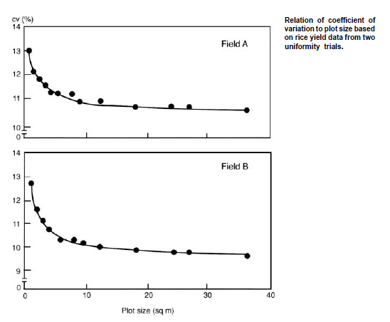

# ขนาด รูปร่าง และการวางแนวแปลง {#sec-plot-size}

การเลือกขนาดและรูปร่างของแปลงทดลองมีความสำคัญอย่างยิ่งในการลดความคลาดเคลื่อนของการทดลอง (Experimental Error) การออกแบบแปลงที่เหมาะสมจะช่วยให้นักวิจัยสามารถตรวจสอบความแตกต่างระหว่างทรีตเมนต์ได้อย่างมีประสิทธิภาพ และใช้ทรัพยากรอย่างมีประสิทธิภาพ

## ขนาดของแปลง (Plot Size)

ขนาดของแปลงที่เหมาะสมขึ้นอยู่กับหลายปัจจัยที่ผสนกัน:

### ปัจจัยที่ต้องพิจารณา

1. **ชนิดของงานทดลอง**: งานทดสอบพันธุ์ (Varietal trials) มักต้องการแปลงขนาดค่อนใหญ่กว่างานทดลองอื่น เนื่องจากพันธุ์ต่างกันมีลักษณะต่างๆ เช่น ความสูง ความแข็งแรง หรือวันเก็บเกี่ยวที่แตกต่างกัน ซึ่งต้องการพื้นที่เพียงพอสำหรับการประเมินลักษณะเหล่านี้

2. **ความแปรปรวนของดิน**: พื้นที่ที่มีความแตกต่างระหว่างความอุดมสมบูรณ์ของดินมาก (High soil heterogeneity) จะต้องการแปลงขนาดใหญ่กว่า เพื่อให้เก็บกลุ่มความแปรปรวนที่มีอยู่ภายในแปลงได้ดีขึ้น (อ้างอิง @sec-soil-heterogeneity)

3. **จำนวนทรีตเมนต์**: ถ้ามีจำนวนทรีตเมนต์น้อย อาจใช้แปลงขนาดใหญ่ได้ แต่ถ้ามีทรีตเมนต์มาก อาจต้องลดขนาดแปลงเพื่อให้จัดการได้ภายในงบประมาณที่มีอยู่

4. **ระยะการปลูกของพันธุ์**: พันธุ์ที่มีระยะปลูกห่างกัน (Wide spacing) เช่น พันธุ์ข้าวดอกสีชมพู 90 จะต้องแปลงขนาดใหญ่กว่าพันธุ์ที่ปลูกหนาแน่น (Narrow spacing)

### ขนาดแปลงที่เหมาะสมสำหรับข้าวในไทย

สำหรับการทดลองข้าวในประเทศไทย ขนาดแปลงที่แนะนำมีดังนี้:

| ประเภทงานทดลอง | ขนาดแปลงที่เหมาะสม | จำนวนซ้ำที่แนะนำ |
|---------------------|----------------------|-------------------|
| การทดสอบพันธุ์ (Varietal trials) | 25-50 m² | 3-4 ซ้ำ |
| การทดสอบปุ๋ย (Fertilizer trials) | 20-40 m² | 3-4 ซ้ำ |
| การทดลองอิทธิพล (Interaction studies) | 15-30 m² | 3-4 ซ้ำ |
| การทดลองในนาเกษตรกร (On-farm trials) | 100-200 m² | 2-3 ซ้ำ |

### ข้อดีและข้อเสียของแปลงขนาดต่างๆ

| | แปลงขนาดใหญ่ | แปลงขนาดเล็ก |
|---|---|---|
| ข้อดี | ลดความคลาดเคลื่อนจากความแปรปรวนของดิน | ใช้พื้นที่น้อย ทดลองได้ในพื้นที่จำกัด |
| | แทนความแปรปรวนของทรีตเมนต์ที่เปลี่ยนแปลงได้ดีกว่า | จัดการง่ายกว่า ลดค่าใช้จ่ายแรงงาน |
| | วัดลักษณะหลายอย่างในแปลงเดียวได้ | ทำซ้ำได้มาก (high replication) |
| ข้อเสีย | ใช้พื้นที่มาก ซึ่งอาจจัดการไม่ได้ในทุกที่ | ความแปรปรวนระหว่างแปลงมักสูงกว่า (high between-plot variance) |
| | ค่าใช้จ่ายในการจัดการและเก็บข้อมูลสูงขึ้น | อาจแทนความแปรปรวนของดินได้ไม่ดี |
| | จัดการยากขึ้นหากแปลงใหญ่เกินไป | ขอบแปลงมีสัดส่วนสูงกว่าแปลงขนาดใหญ่ |

: Advantages and disadvantages of large and small plots {#tbl-plot-size-tradeoff}

### ตัวอย่างการคำนวณขนาดแปลง

สมมติคุณมีพื้นที่ 40 m x 50 m (2,000 m²) และต้องการทดลอง 6 ทรีตเมนต์ด้วย 4 ซ้ำ (RCBD) แต่ละแปลงต้องมีขนาด 30 m²

**วิธีการคำนวณ:**

1. คำนวณพื้นที่ทั้งหมดที่ต้องการ: 6 ทรีตเมนต์ × 4 ซ้ำ = 24 แปลง
2. คำนวณพื้นที่ทั้งหมด: 24 แปลง × 30 m² = 720 m²
3. เปรียบเทียบกับพื้นที่ที่มี: 720 m² < 2,000 m²

ดังนั้น คุณสามารถทำการทดลองในพื้นที่นี้ได้พร้อมเพิ่มพื้นที่ว่างรอบนอกแปลงสำหรับการสังเกตและจัดการ

## รูปร่างของแปลง (Plot Shape)

### หลักการสำคัญ

โดยทั่วไป แปลงรูปสี่เหลี่ยมผืนผ้าที่ยาวขนานไปกับแนวของความผันแปร (Gradient) จะช่วยลดความคลาดเคลื่อนได้ดีที่สุด เนื่องจากทำให้หน่วยสุ่มภายในบล็อกเดียวกันมีความสม่ำเสมอกันมากขึ้น

### รูปร่างที่นิยมใช้

1. **สี่เหลี่ยมผืนผ้า (Rectangular)**: รูปร่างที่นิยมใช้ที่สุด เหมาะสมเมื่อรู้จักแนวของความผันแปรของดิน

2. **สี่เหลี่ยมจัตุรัส (Square)**: เหมาะสมเมื่อไม่รู้จักแนวของความผันแปร หรือเมื่อความผันแปรแกวกันทุกทิศทาง

3. **L-shaped**: ใช้บางครั้งเมื่อมีข้อจำกัดเรื่องพื้นที่ แต่มักจะลดประสิทธิภาพในการจัดการ

### อัตราส่วนความยาวต่อความกว้าง (Length to Width Ratio)

- **แปลงรูปสี่เหลี่ยมจัตุรัส**: 1:1 (เท่ากัน)
- **แปลงรูปสี่เหลี่ยมผืนผ้าที่ดี**: 3:1 ถึง 5:1
- **แปลงรูปสี่เหลี่ยมผืนผ้าที่สูงเกินไป**: > 5:1 (ควรหลีกเลี่ยง)

### ตัวอย่าง

หากแปลงนามีแนวความอุดมสมบูรณ์ที่แตกต่างกันจากเหนือไปล่าง (North-South gradient):

**ไม่เหมาะสม**: แปลงยาวในแนวตะวัน-ตกวัน (East-West) จะทำให้หน่วยที่อยู่ห่างกันในบล็อกเดียวกันมีความแตกต่างกันมาก

**เหมาะสม**: แปลงยาวในแนวเหนือ-ใต้ (North-South) จะทำให้หน่วยที่อยู่ในแนวเดียวกันมีความอุดมสมบูรณ์ใกล้เคียงกัน

## การวางแนวแปลง (Plot Orientation)

การวางแนวของแปลงคือการเลือกทิศทางของแปลงยาว ซึ่งมีความสำคัญอย่างยิ่งในการลดผลกระทบจากความแปรปรวนของดิน

### วิธีการวางแนวแปลง

1. **เมื่อรู้จักแนวของความผันแปร**: วางแนวแปลงยาวให้ขนานไปกับแนวของความผันแปร และวางแนวบล็อกตั้งฉาก (Perpendicular) กับแนวความผันแปร

2. **เมื่อไม่รู้จักแนวของความผันแปร**: วางแปลงให้มีรูปทรงใกล้เคียงสี่เหลี่ยมจัตุรัสมากที่สุดเท่าที่จะเป็นไปได้

3. **พิจารณาแนวทางเดินและระบายน้ำ**: ควรวางแนวแปลงให้จัดการง่าย และไม่รบกวนกับแนวที่ดินมีการไหลของน้ำ

### ผลของการวางแนวที่ไม่เหมาะสม

- เพิ่มความคลาดเคลื่อนของการทดลอง
- ลดความแม่นยำในการประเมินความแตกต่างระหว่างทรีตเมนต์
- อาจทำให้การจัดการลำบากขึ้น

## พิจารณาร่วมของขนาด รูปร่าง และการวางแนวแปลง

เมื่อออกแบบแปลง ควรพิจารณาปัจจัยทั้งสามประการร่วมกัน:

| ปัจจัย | ขนาดแปลง | รูปร่าง | การวางแนว |
|---------|------------|-----------|--------------|
| ความแปรปรวนของดิน | ใหญ่ในดินที่แตกต่างมาก | สี่เหลี่ยมจัตุรัสเมื่อไม่รู้แนว | ขนานแนวความผันแปร |
| จำนวนทรีตเมนต์ | เล็กในทรีตเมนต์มาก | สี่เหลี่ยมผืนผ้าสำหรับทรีตเมนต์น้อย | - |
| พันธุ์ | ใหญ่ในพันธุ์ระยะปลูกห่าง | - | - |
| ความง่ายในการจัดการ | เล็กถ้าพื้นที่จำกัด | สี่เหลี่ยมจัตุรัสสำหรับจัดการง่าย | จัดง่ายและตามแนวดิน |

## คำแนะนำสำหรับนักวิจัยข้าว

1. **ทำ Uniformity Trial**: หากเป็นไปได้ ควรปลูกพันธุ์เดียวทั้งพื้นที่ด้วยการจัดการที่สม่ำเสมอ เพื่อสร้างแผนที่ความอุดมสมบูรณ์ (Fertility contour maps) ซึ่งจะช่วยในการวางแนวแปลงและบล็อกให้ถูกต้อง

2. **ใช้ข้อมูลจากการทดลองก่อนหน้า**: ถ้าพื้นที่เคยใช้ทดลองมาก่อนหน้านี้ ให้ตรวจสอบข้อมูลการทดลองเหล่านั้นเพื่อหาแนวของความอุดมสมบูรณ์และความแปรปรวนของดิน

3. **อ้างอิงมาตรฐาน**: ติดตามมาตรฐานจากกรมวิชาการเกษตร (DOA) และสถาบันวิจัยข้าวเกี่ยวกับขนาดแปลงที่เหมาะสม

<!-- ภาพสแกนจาก Gomez (1972) รอวาดใหม่ด้วย R (ต้องมีข้อมูล CV รายขนาดแปลงจาก uniformity trial)
     คำบรรยายเดิม "ตัวอย่างการวางแผนผังแปลงทดลอง RCB ..." ไม่ตรงกับภาพ ภาพจริงคือ CV กับขนาดแปลง จึงแก้คำบรรยายให้ตรงภาพ -->

{#fig-cv-plot-size fig-alt="Two panels showing the CV of rice yield, in percent, decreasing as plot size increases from 1 to about 36 square metres, levelling off near 10.5 percent in Field A and 9.7 percent in Field B."}
