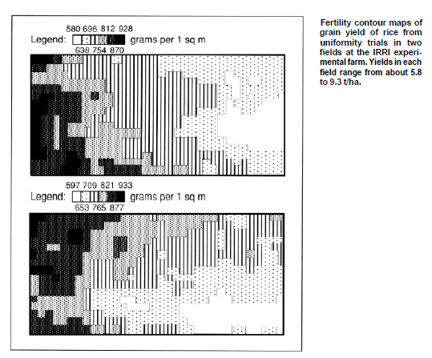
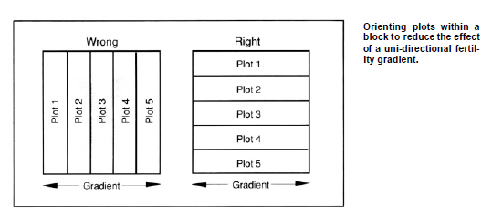

# ความไม่สม่ำเสมอของดิน {#sec-soil-heterogeneity}

**ความไม่สม่ำเสมอของดิน (Soil heterogeneity)** หมายถึงความไม่เป็นเนื้อเดียวกันของดินจากส่วนหนึ่งของพื้นที่ไปยังอีกส่วนหนึ่ง แม้ในพื้นที่ขนาดเล็ก ดินก็อาจมีความแตกต่างกันอย่างมากในด้านเนื้อดิน (texture) การระบายน้ำ ความชื้น และธาตุอาหารที่พืชนำไปใช้ได้ ความแปรปรวนนี้มักปรากฏอยู่เสมอแม้ในพื้นที่ที่ดูเหมือนจะสม่ำเสมอกัน จากการทดลองความสม่ำเสมอ (Uniformity trials) ในฟาร์มทดลองของ IRRI พบว่าผลผลิตข้าวมีความแตกต่างกันอย่างมากในแต่ละส่วนของพื้นที่ รูปแบบที่พบได้บ่อยในนาข้าวลุ่มคือการเปลี่ยนแปลงระดับผลผลิตแบบค่อยเป็นค่อยไป (gradual change) จากด้านหนึ่งไปยังอีกด้านหนึ่ง มากกว่าความแตกต่างแบบเป็นหย่อมๆ (patchy differences)

<!-- ภาพสแกนจาก Gomez (1972) รอวาดใหม่ด้วย R หรือ mermaid -->

{#fig-fertility-contour fig-alt="Two shaded contour maps of grain yield across a field, darker shading on the left side indicating higher yield and lighter shading on the right."}

## ผลของความไม่สม่ำเสมอของดิน

ความไม่สม่ำเสมอของดินเป็นปัจจัยสำคัญที่ก่อให้เกิดความคลาดเคลื่อนในการทดลองภาคสนาม ทำให้เกิดความไม่แน่นอนในการสรุปผลจากข้อมูลผลผลิต หากไม่ได้รับการควบคุมอย่างเหมาะสม จะเพิ่มความคลาดเคลื่อนจากการทดลองและลดความแม่นยำของผลการทดลองลง

## การลดความไม่สม่ำเสมอของดิน

วิธีพื้นฐานในการลดปัญหามีดังนี้:

-   **หลีกเลี่ยงพื้นที่ที่มีประวัติการทดลองที่ส่งผลต่างกันต่อสภาพดิน:** เช่น พื้นที่ที่เคยใช้ทดลองปุ๋ย พันธุ์ข้าวที่มีอายุเก็บเกี่ยวต่างกัน หรือระยะปลูกที่ต่างกัน หากจำเป็นต้องใช้พื้นที่ดังกล่าว ควรปลูกพืชที่สม่ำเสมอกันหนึ่งรอบหรือมากกว่าก่อนจะเริ่มการทดลองใหม่

-   **หลีกเลี่ยงพื้นที่ที่เคยมีทางเดิน (alleys) ที่ไม่ได้ปลูกพืชในฤดูกาลก่อน:** เพราะพืชที่ปลูกในจุดที่เป็นทางเดินเก่ามักเจริญเติบโตได้ดีกว่าปกติ

-   **ใช้พื้นที่ที่มีข้อมูลประวัติการใช้ประโยชน์ที่ดิน:** ข้อมูลนี้จะช่วยระบุสาเหตุที่เป็นไปได้ของความไม่สม่ำเสมอที่เพิ่มขึ้น เพื่อหามาตรการแก้ไขที่เหมาะสม

-   **การทำ Uniformity trial:** หากเป็นไปได้ ควรปลูกพืชพันธุ์เดียวทั้งพื้นที่ด้วยการจัดการที่สม่ำเสมอ เพื่อสร้างแผนที่ความอุดมสมบูรณ์ (Fertility contour maps) ซึ่งข้อมูลนี้จะช่วยในการวางแนวแปลงและบล็อกให้ถูกต้องในงานทดลองถัดไป

## การลดอิทธิพลของความไม่สม่ำเสมอของดิน

แม้เราจะกำจัดความไม่สม่ำเสมอของดินออกไปไม่ได้ทั้งหมด แต่เทคนิคการทดลองที่ถูกต้องสามารถลด "ผลกระทบ" ของมันได้:

1.  **เลือกแผนการทดลองที่เหมาะสม:** ใช้การจัดกลุ่ม (Blocking) ที่สอดคล้องกับรูปแบบความแปรปรวน เช่น ใช้ RCB สำหรับแนวความอุดมสมบูรณ์ทิศทางเดียว หรือ Latin Square สำหรับสองทิศทาง

2.  **เลือกขนาดและรูปร่างแปลงที่เหมาะสม:** เช่น ใช้แปลงขนาดค่อนข้างใหญ่สำหรับดินที่มีความแปรปรวนแบบเป็นหย่อมๆ หรือใช้แปลงสี่เหลี่ยมจัตุรัสเมื่อไม่ทราบรูปแบบดินที่ชัดเจน

3.  **การวางแนวแปลงและบล็อกที่ถูกต้อง:** จัดวางบล็อกให้ความแตกต่างระหว่างบล็อกมีค่าสูงสุด และแปลงภายในบล็อกมีความสม่ำเสมอมากที่สุด (วางแนวแปลงด้านยาวไปตามทิศทางที่มีความแปรปรวนสูงสุดภายในบล็อก)

4.  **เพิ่มจำนวนซ้ำ:** สำหรับความแม่นยำในระดับเดียวกัน พื้นที่ที่มีดินไม่สม่ำเสมอต้องการจำนวนซ้ำมากกว่าพื้นที่ที่มีดินสม่ำเสมอ

<!-- ภาพสแกนจาก Gomez (1972) รอวาดใหม่ด้วย R หรือ mermaid -->

{#fig-plot-orientation fig-alt="Two blocks of five plots. Left, labelled Wrong, has plots running across the gradient arrow; right, labelled Right, has plots stacked so each plot lies along one fertility level."}

## ตัวอย่างความไม่สม่ำเสมอของดินในนาข้าวไทย

### ตัวอย่างที่ 1: นาหว่านในเขตราบนากลางแมนน้ำ

**สถานการณ์:** นาหว่านที่ตั้งอยู่ในเขตราบนากลางแมนน้ำ ซึ่งมีความแตกต่างระดับน้ำและความอุดมสมบูรณ์ของดินสูง

**ปัจจัยที่ส่งผล:**
- ความแปรปรวนของดินมากเนื่องจาก:
  * ความแตกต่างระดับน้ำจากจุดระบายน้ำ (ปลูกใกล้แมนน้ำ) ไปสู่จุดไกลจากแมนน้ำ
  * ความแตกต่างของดินจากการตกตะกอนของตะกอน (Light and heavy soils)
  * แนวของการเคลื่อนที่สะสมของดินจากแมนน้ำ

- แนวความอุดมสมบูรณ์: ค่าสูงสุดอยู่ใกล้แมนน้ำ, ค่าต่ำสุดอยู่ไกลจากแมนน้ำ

**แนวทางจัดการ:**
1. วางแนวบล็อกให้ตั้งฉากกับแมนน้ำ (Perpendicular to water gradient)
2. ใช้แปลงขนาดใหญ่กว่าปกติสำหรับนาหว่าน
3. เพิ่มจำนวนซ้ำ (5-6 ซ้ำ) เพื่อควบคุมความแปรปรวน
4. ใช้พันธุ์ข้าวที่มีความแข็งแรงกับความทนทานต่อการแปรปรวนของดิน

### ตัวอย่างที่ 2: นาหว่านในพื้นที่ที่มีร่องดินและพื้นที่สูงต่ำกัน

**สถานการณ์:** นาหว่านที่มีพื้นที่สูงต่ำกัน (Terraced rice fields) ซึ่งมีความแตกต่างของความอุดมสมบูรณ์ของดินสูงตามแนวระดับพื้นที่

**ปัจจัยที่ส่งผล:**
- แต่ละระดับพื้นที่มีความอุดมสมบูรณ์ต่างกันอย่างชัดเจน
- ดินแต่ละระดับมีลักษณะต่างกัน (เช่น ดินดีน้ำต่อ ดินระบายน้ำ)
- ความแปรปรวนภายในระดับเดียวอาจมาก แต่ระหว่างระดับมีความแตกต่างชัดเจน

**แนวทางจัดการ:**
1. วางแนวบล็อกตามระดับพื้นที่ (ทุกบล็อกอยู่ในระดับเดียว)
2. วางแนวแปลงยาวให้ตั้งฉากกับแนวระดับพื้นที่
3. ใช้พันธุ์ข้าวที่เหมาะสมกับแต่ละระดับพื้นที่
4. ทำ Uniformity Trial ในแต่ละระดับพื้นที่ก่อนเริ่มการทดลอง

### ตัวอย่างที่ 3: นาเกษตรกรในภาคกลาง

**สถานการณ์:** นาของเกษตรกรในภาคกลาง ซึ่งมีความแตกต่างของความอุดมสมบูรณ์ของดินสูงมากเนื่องจาก:

1. การใช้ปุ๋ยที่แตกต่างกันมากในระหว่างแปลง
2. ระยะระหว่างการจัดการที่ไม่สม่ำเสมอ
3. ความแตกต่างของพื้นที่รอบนอกแปลงทดลอง

**ปัจจัยที่ส่งผล:**
- ค่า CV สูงกว่าในสถานีทดลอง
- การประเมินความแตกต่างระหว่างทรีตเมนต์ทำได้ยาก
- ผลการทดลองอาจไม่เป็นตัวแทนของพื้นที่อื่น

**แนวทางจัดการ:**
1. ทำ Uniformity Trial ก่อนการทดลองใหญ่
2. วางแนวบล็อกให้มีจำนวนน้อยในบล็อกเดียวกัน (4-5 ทรีตเมนต์)
3. ใช้พันธุ์ข้าวที่มีความคล้ายทาน (Standard variety) เป็นทรีตเมนต์อ้างอิง
4. ควบคุมปัจจัยอื่นที่เป็นไปได้ให้มากที่สุด (เช่น ระยะระหว่างการจัดการ)

## คำแนะนำสำหรับนักวิจัยข้าวในไทย

1. **ทำ Uniformity Trial ก่อนเริ่มการทดลองใหญ่**: ช่วยให้การรู้จักรูปแบบความอุดมสมบูรณ์ของดินและสามารถวางแผนทดลองได้อย่างเหมาะสม

2. **ใช้แผนผังแปลงที่สร้างด้วยซอฟต์แวร์**: ใช้แพ็กเกจ agricolae ใน R เพื่อสร้างแผนผังแปลงที่มีการจัดบล็อกที่เหมาะสมกับรูปแบบความอุดมสมบูรณ์

3. **บันทึกข้อมูลการจัดการในแต่ละบล็อก**: บันทึกวันที่ใส่ปุ๋ย วันที่ปลูก วันที่ใส่สารเคมี ฯลฯ เพื่อใช้ในการวิเคราะห์ความแปรปรวนของดิน

4. **อ้างอิงมาตรฐานจากกรมวิชาการเกษตร (DOA)**: ใช้ค่าเฉพาะและข้อแนะนำเกี่ยวกับการจัดการความไม่สม่ำเสมอของดินในการทดลองข้าว
