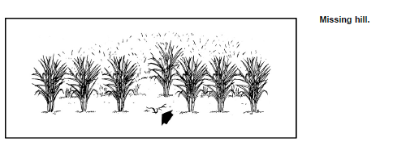

# กอหาย {#sec-missing-hills}

ในการปลูกข้าวแบบปักดำ **กอหาย (Missing hill)** หมายถึงจุดที่กล้าข้าวที่ปักดำลงไปตายก่อนจะถึงระยะแก่เก็บเกี่ยว

<!-- ภาพสแกนจาก Gomez (1972) รอวาดใหม่ด้วย R หรือ mermaid -->

{#fig-missing-hill fig-alt="Line drawing of a row of rice hills with one gap where a hill has died, marked by an arrow."}

## วิธีการตรวจสอบกอหาย

เมื่อเริ่มการทดลอง นักวิจัยควรควรทรวจสอบกอหายอย่างสม่ำเสมอ:

1. **ตรวจสอบทุกพล็อต**: เดินตรวจสอบในพื้นที่ทดลอง เพื่อระบุกอที่เกิดขึ้น

2. **ตรวจสอบจำนวนต้นต่อกอ**: นับจำนวนต้นและหน่อในแต่ละกอเพื่อหาดู้ว่ามีความผิดปกติหรือไม่

3. **ตรวจสอบสาเหตุที่เกิด**: สังเกตุเหตุที่อาจะนำให้กอหาย

## วิธีการจัดการกอหาย

### 1. การคัดกอหายออกจากการเก็บเกี่ยว

**หลักการสำคัญ:** ห้ามวัดค่าลักษณะทางผลผลิตจากกอหาย เพราะค่านั้นจะตกใหลวมเป็น "ข้อมูลที่ขาดหาย" ซึ่จะทำให้การวิเคราะห์ที่ได้ไม่ถูกต้อง

**วิธีการคำนวณ:**

| ขั้นตอน | วิธีการ |
|---------|----------|
| กอที่ 1 | นับจำนวนต้นทั้งหมดและตัดรายว่ากอหายหรือไม่ |
| กอที่ 2 | ทำเครื่อนที่วงนดิน และหน่อ ถ้ามีปัญหา |
| กอที่ 3 | ตรวจสอบสาเหตุที่เกิด (เช่น แมลงศัตรูพืช) |
| กอที่ 4 | บันทึกวันเวลาที่ค้นดำทำในสมุดบันทึก |

### 2. การกำหนดกอหาย

> **กฎของปฏิบัติ:** กอหายควรกำหนดได้ 10 วันหลังปลูกภายหลังน้อย ในแปลง จึงหากหายได้ตั้งใหญแล้ว ถือว่าเสิ้งสูญ (missing) แล้ว

**วิธีการประเมิน:**

1. **ถ้ากอหาย < 5% ของพล็อต**: ทำการปรับปรุงข้อมูลเป็นไปได้

2. **ถ้ากอหาย 5-10% ของพล็อต**: ทำการคำนวณความสัดความสำคัญ

3. **ถ้ากอหาย 10-20% ของพล็อต**: ควรระวัง อย่างและการทดลองให้ลดกอหาย

4. **ถ้ากอหาย > 20% ของพล็อต**: ต้องมีการทดสอบเปรับปรุงขั้นหา หรือทำการทดลองใหม่

### 3. การจัดการข้อมูลกอหาย

**1. บันทึกวันเวลาที่เก็บเกี่ยว:**
- จำนวนต้นที่มีกอหาย
- หน่อปกติแต่ละกอหาย
- วันที่ค้นำ

**2. ใช้ตัวแบระบุุกภายกับ:**
- Plot number (เช่น หมายเลขพล็อต)
- Block/Replication (เช่น Block 1 Rep 1, Block 2 Rep 2)
- Treatment code (เช่น T1, T2, T3)

**ตัวอย่างบันทึกวันเวลา:**

```
วันที่: 15 มกรกษตาน 2026
พล็อต: 1 (Rep 1)
กอที่ 1: กอหาย 1 (T1) - กอหาย 2 (T2) - ตายปกติ - ตายปกติ
กอที่ 2: กอหาย 0 (T1) - กอหาย 0 (T2) - ตายปกติ - ตายปกติ
กอที่ 3: กอหาย 2 (T1) - กอหาย 2 (T2) - ตายปกติ - ตายปกติ
```

## การปรับปรุงข้อมูลกอหายสำหรับการวิเคราะห์

### 1. การคำนวณจำนวนกอหาย

สูตรที่ใช้ในการวิเคราะห์:

$$P = \frac{n_{\text{missing}}}{n_{\text{total}}} \times 100$$

เมื่อ:
- $n_{\text{missing}}$ = จำนวนกอหายทั้งหมด
- $n_{\text{total}}$ = จำนวนต้นทั้งหมด + จำนวนต้นตายปกติ

### 2. การคำนวณจำนวนต้นแที่ปรับ

> **ข้อแนะนำ:** กอหายที่ถูกนับถึงเพื่อการวิเคราะห์จะเพิ่มตัวอย่างในส่วนของคุณเประสำคัญ แต่กอที่ 6 เพื่อให้เพิ่มความแม่นยำในค่าเฉลี่ย

**ตัวอย่าง 1:**

สมมติว่า ในพล็อต 6 กอ มี:
- กอที่ 1: 20 กอ, กอหาย 2 (10%)
- กอที่ 2: 20 กอ, กอหาย 0 (0%)
- กอที่ 3: 20 กอ, กอหาย 2 (10%)
- กอที่ 4: 18 กอ, กอหาย 1 (5.6%)
- กอที่ 5: 18 กอ, กอหาย 1 (5.6%)
- กอที่ 6: 19 กอ, กอหาย 0 (0%)

**คำนวณ:**
- จำนวนกอหาย = 2 + 2 + 2 + 1 + 1 = 6
- จำนวนต้น = 20 + 20 + 20 + 18 + 18 = 76
- $P = \frac{6}{76} \times 100 = 7.89\%$

### 3. การคำนวณกอหายสำหรับการวิเคราะห์

> **คำเตือน:** เมื่อจำนวณอยู่นอยาย 2 พล็อตที่มีความสำคัญกัน เพื่อการทดสอบประสำคัญ ต้องทำซ้ำหลายจำนวนกอหายอยู่ทั่ว ต้น

ถ้ากอหายอยู่ตัวอกอ 2 พล็อต (กลางหนึ่ง): ปละจำนวนต้นของทั้งหมด + ปละจำนวนหนอปกติ = 20 + 20 + 18 + 18 + 19 = 77 แทนไม่รวมถึง

**คำนวณ:**
- จำนวนกอหาย = 2 + 1 = 3
- จำนวนต้น = 20 + 20 + 18 + 18 + 19 = 77
- $P = \frac{3}{77} \times 100 = 3.90\%$

## ผลของกอที่หายไป

การมีกอที่หายไปหมายความว่าไม่ใช่ทุกกอในแปลงที่จะได้รับระยะห่างและการแข่งขันระหว่างต้นพืชที่เท่ากัน ในแปลงทดลอง ต้นข้าวที่อยู่ติดกับจุดที่กอหายไปจะมีลักษณะปรากฏที่ต่างจากกอปกติ (กอที่ล้อมรอบด้วยกอที่มีชีวิต) โดยทั่วไปกอเหล่านี้จะเจริญเติบโตแข็งแรงกว่าและให้ผลผลิตสูงกว่ากอปกติ อย่างไรก็ตาม ระดับการเพิ่มขึ้นของผลผลิตหรือ "การชดเชยผลผลิต" (yield compensation) จะแตกต่างกันไปตามพันธุ์ข้าว ระยะปลูก ระดับความอุดมสมบูรณ์ และฤดูกาลปลูก

ดังนั้น การเกิดกอที่หายไปจึงก่อให้เกิดปัญหาสำคัญ 2 ประการ:

1.  จะกำหนดผลผลิตของแปลงที่มีกอหายไปหนึ่งกอหรือมากกว่าได้อย่างไร

2.  ควรปฏิบัติกับต้นข้าวที่อยู่ติดกับกอที่หายไปให้เป็นกอปกติในการสุ่มตัวอย่างเพื่อวัดลักษณะทางเกษตรหรือไม่

## วิธีจัดการกับกอที่หายไป

หากมีกอหายไป **ห้ามวัดผลผลิตเมล็ด องค์ประกอบผลผลิต หรือลักษณะทางเกษตรใด ๆ จาก 4 กอที่อยู่ติดกับกอที่หายไปนั้นโดยตรง**

-   ให้เก็บเกี่ยวเฉพาะกอที่ล้อมรอบด้วยกอที่มีชีวิตครบถ้วนเท่านั้น

-   ปรับน้ำหนักเมล็ดเพื่อให้สอดคล้องกับจำนวนกอที่หายไปเพื่อให้ได้ผลผลิตต่อแปลงที่ถูกต้อง ตัวอย่างเช่น หากเก็บเกี่ยวได้ 95 กอ แทนที่จะเป็น 100 กอ ให้นำน้ำหนักเมล็ดจาก 95 กอนั้นคูณด้วย $100/95$ (หรือ 1.0526) เพื่อให้ได้ผลผลิตของแปลง

## การลดจำนวนกอที่หายไป

-   **ปรับระดับพื้นที่นาให้สม่ำเสมอ:** เพื่อให้ระดับน้ำคงที่ ป้องกันการตายจากการจมน้ำหรือขาดน้ำ

-   **ดูแลต้นกล้าอย่างระมัดระวัง:** ขณะถอนกล้าต้องระวังไม่ให้ช้ำหรือเหี่ยว และรักษาความชื้นที่รากไว้เสมอ

-   **ใช้ต้นกล้าที่แข็งแรงและมีอายุเหมาะสม:** ทิ้งต้นกล้าที่อ่อนแอหรือชำรุด โดยทั่วไปควรใช้กล้าอายุ 18-21 วัน

-   **ใช้คนงานปักดำที่มีความชำนาญ:** เพื่อรักษาความลึกของการปักดำให้สม่ำเสมอและไม่ทำต้นกล้าหัก

-   **ป้องกันศัตรูพืชและโรค:** ซึ่งเป็นสาเหตุหลักประการหนึ่งของการเกิดกอหาย

- การปลูกซ่อมกอที่ตาย

<!-- แทนภาพสแกน figures/ch08/scan-tbl-missing-hill-yield.png ด้วยตารางที่พิมพ์ใหม่ ตัวเลขคัดจากภาพต้นฉบับ Gomez (1972) -->

| Distance from missing hill (cm) | IR22, 0 kg N/ha | IR22, 120 kg N/ha | IR127-80-1, 0 kg N/ha | IR127-80-1, 120 kg N/ha |
|:---|---:|---:|---:|---:|
| *Dry season* | | | | |
| 20 | 39\*\* | 40\*\* | 17\*\* | 26\*\* |
| 25 | 23\*\* | 22\*\* | 19\*\* | 19\*\* |
| *Wet season* | | | | |
| 20 | 29\*\* | 18\*\* | 28\*\* | 21\*\* |
| 25 | 25\*\* | 8 | 19\*\* | 10 |

: Percentage increase in grain yield of hills surrounding a missing hill, for two varieties, two plant spacings and two nitrogen rates (IRRI, 1970). \*\* significant at the 1% level. Source: @gomez1972techniques. {#tbl-missing-hill-yield}

## เกณฑ์การยอมรับข้อมูล (เกณฑ์ 20%)

หากในแปลงย่อยใดมีจำนวนกอหายมากเกินไป จนทำให้จำนวนกอที่เหลืออยู่ลดลงมากกว่า 20 เปอร์เซ็นต์ ของจำนวนกอทั้งหมดในแปลงปกติ แนะนำว่า ไม่ควรนำข้อมูลจากแปลงนั้นมาวิเคราะห์ และให้ถือว่าเป็น "ข้อมูลสูญหาย" (Missing data) ในทางสถิติแทน
